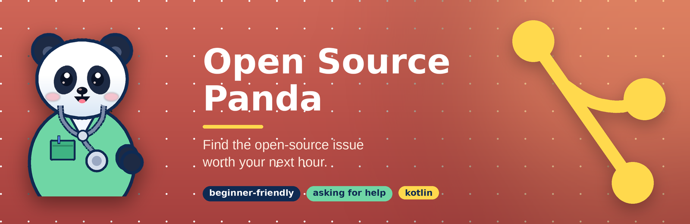
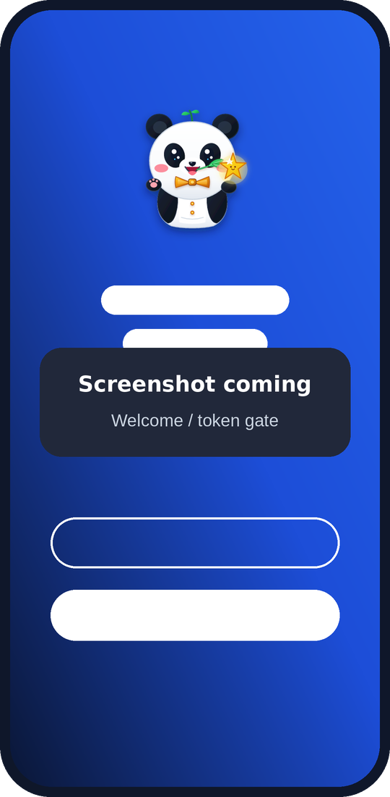
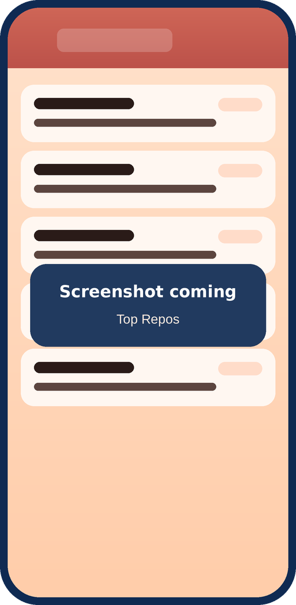
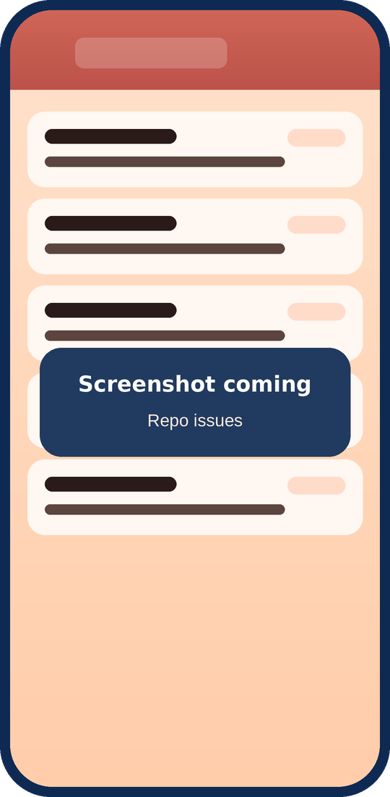
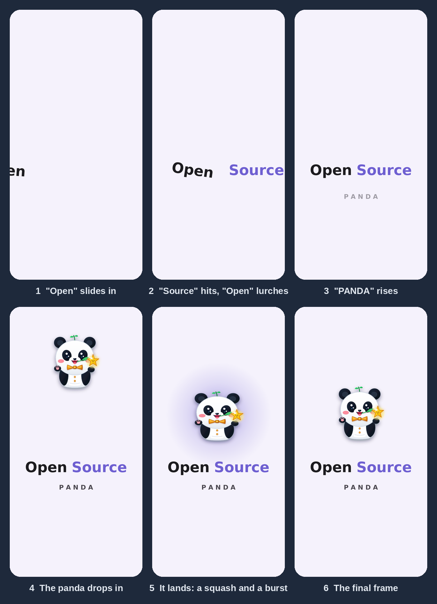
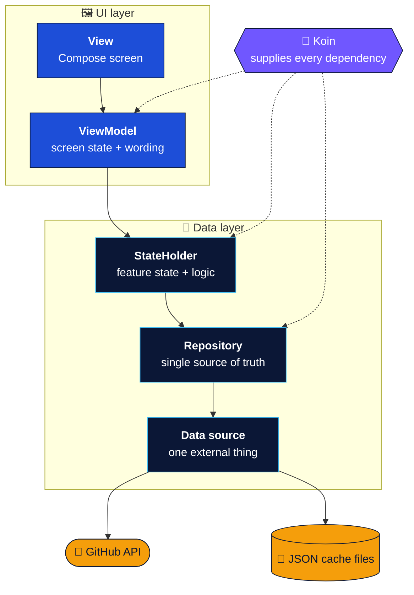
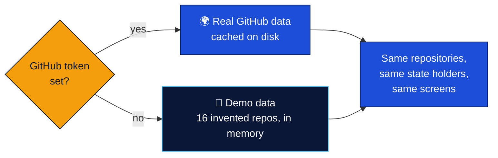

<div align="center">



<br>

**An Android app for finding open-source issues on GitHub that are actually worth working on.**<br>
The top projects with open issues that suit beginners, or that are asking for help, by language, one tap from the issues themselves.

<br>

[](https://github.com/GeneSJC/OpenSourcePanda_Kotlin/actions/workflows/ci.yml)


[](LICENSE)

[**What it does**](#what-it-does) &nbsp;·&nbsp; [**Screens**](#screens) &nbsp;·&nbsp; [**Run it**](#run-it) &nbsp;·&nbsp; [**Developer tools**](#developer-tools) &nbsp;·&nbsp; [**Architecture**](#architecture) &nbsp;·&nbsp; [**Tech stack**](#tech-stack) &nbsp;·&nbsp; [**Docs**](#docs) &nbsp;·&nbsp; [**Status**](#status)


</div>

<a id="what-it-does"></a>

## ✨ What it does

Open source runs on people picking up the first issue they can handle. Open Source Panda does the searching for you: pick
a kind of issue and a language, and it lists the repositories with the most open matches, each with its issues one tap away.

<table>
  <tr>
    <td width="33%" valign="top">
      <h4>🎯 Two kinds of issue</h4>
      <b>Beginner-friendly issues</b> for getting started, <b>projects asking for help</b> for more experience. (On GitHub these are the "good first issue" and "help wanted" labels.) Each mode tints the whole app in its own colors.
    </td>
    <td width="33%" valign="top">
      <h4>🌐 By language</h4>
      Any, Kotlin, Java, Swift, JavaScript or Python, with the repositories ranked by how many open issues match.
    </td>
    <td width="33%" valign="top">
      <h4>📖 README previews</h4>
      Each repo card shows the start of its README, and expands to read more, so you know what a project is before you open it.
    </td>
  </tr>
  <tr>
    <td valign="top">
      <h4>🔖 Bookmark and hide</h4>
      Save issues for later, or hide the ones you do not want, with an Undo. Real and demo data keep their own lists.
    </td>
    <td valign="top">
      <h4>📊 A rate-limit meter</h4>
      GitHub limits its search API. A small dial shows how much is left, and the app spends the allowance carefully.
    </td>
    <td valign="top">
      <h4>🧪 A demo mode</h4>
      No token yet? <b>Try the demo</b>: sixteen invented repositories across all five languages, so every screen has something to show.
    </td>
  </tr>
</table>

> [!TIP]
> To see **real** issues the app needs a free GitHub token with **no permissions at all** (it only reads public data). The
> first screen walks you through making one in about a minute. The token is stored encrypted on your device, shown masked,
> and sent only to GitHub.

<a id="screens"></a>

## 📱 Screens

<div align="center">

<table>
  <tr>
    <td align="center"><br><sub><b>Welcome</b><br>the token gate</sub></td>
    <td align="center"><br><sub><b>Top Repos</b><br>by language and mode</sub></td>
    <td align="center"><br><sub><b>Repo issues</b><br>one tap from the list</sub></td>
  </tr>
</table>

</div>

<sub>Real screenshots are on the way; the phones above are placeholders (see [`docs/images`](docs/images/README.md)).</sub>

<details>
<summary><b>The launch animation</b> (an illustration; click to expand)</summary>

<br>

<div align="center">



<sub>Six frames of the launch animation, drawn from its design (they are not captures of the running app).<br>The title builds itself, then the panda drops in above it and lands with a burst of light.</sub>

</div>

</details>

<a id="run-it"></a>

## 🚀 Run it

**You need** Android Studio (current stable) and a JDK to launch Gradle (CI uses 21; Gradle downloads the compile toolchain
itself). The app runs on Android 7.0 (API 24) and newer.

> [!NOTE]
> **Which branch?** `develop` is the default and holds the latest code. `main` holds the latest stable release. Short-lived `feature-set/*` and `refinement/*` branches carry work in progress.

```bash
git clone https://github.com/GeneSJC/OpenSourcePanda_Kotlin.git
cd OpenSourcePanda_Kotlin
```

1. Open the folder in Android Studio and let Gradle sync.
2. Pick a build variant (**Build Variants** panel): `fossDebug` is the default, `commercialDebug` is the Google Play build.
3. Run it on a device or emulator.
4. On the first screen, tap **How does it work?** for the token steps, or **Try the demo** to look around right away.

<details>
<summary><b>Command line, tests and checks</b></summary>

```bash
# build a debug APK for each flavor
./gradlew assembleFossDebug assembleCommercialDebug

# unit tests (name both flavors: the bare task names are ambiguous with two flavors)
./gradlew testFossDebugUnitTest testCommercialDebugUnitTest

# the same checks CI runs
./scripts/check-no-ads-sdk.sh           # neither flavor contains an ads library
./scripts/check-release-has-no-token.sh # no release build contains a developer token
```

**A token for your own debug builds.** Put `GITHUB_API_TOKEN=ghp_yourtoken` in `local.properties` (it is git-ignored) and
debug builds start with it, skipping the welcome screen. Release builds never include it. More about running the tests and the CI
setup is in [`_meta/docs/README_01.md`](_meta/docs/README_01.md).

</details>

<a id="developer-tools"></a>

## 🛠️ Developer tools

Small command-line tools keep verification fast and repeatable, and CI runs the same ones, so a green run on your machine means a green run there.

| Tool | What it does | When to run it |
|---|---|---|
| `./scripts/verify-all.sh` | Everything below in one command: tests and debug builds for both flavors, then both safety checks. Stops at the first failure and says which step it was | Before you push |
| `./gradlew testFossDebugUnitTest testCommercialDebugUnitTest assembleFossDebug assembleCommercialDebug` | Unit tests and debug builds for both flavors. Both are named because the bare task names are ambiguous with two flavors | After any code change; a `foss`-only run can miss a break in the `commercial` source folder |
| `./scripts/check-no-ads-sdk.sh` | Proves neither flavor contains an ads or consent library or an ads manifest entry | After any dependency change |
| `./scripts/check-release-has-no-token.sh` | Proves no release build carries a developer token, and that the check can tell (the debug builds must contain it) | After any change to build config or token handling |
| `python3 docs/images/make_art.py` | Regenerates the README banner, divider, mascot and placeholder screens | After a rename or a color change |
| `python3 docs/images/make_splash_storyboard.py` | Redraws the launch-animation storyboard shown under Screens | After changing the splash animation |
| `python3 docs/images/make_launcher_icons.py` | Regenerates the launcher icon backgrounds and the pre-Android-8 icons | After changing the icon colors |
| [`.github/workflows/ci.yml`](.github/workflows/ci.yml) | Runs the tests, both builds and both checks on every push and pull request to `develop` and `main` | Automatic |

<a id="architecture"></a>

## 🏗️ Architecture

One direction only, with every layer doing one job. The standard Android stack:



| Layer | Owns | Must not |
|---|---|---|
| **View** | Layout, local UI state (animations, dialogs, expanded flags) | Hold data state or call a repository |
| **ViewModel** | The state the screen shows, the wording, one-off events | Hold the feature's data logic, or know about files and network |
| **StateHolder** | A feature's data state and the logic that changes it | Contain user-facing wording, or call the network or disk directly |
| **Repository** | The source of truth for one kind of data (fetched, stored, cached) | Know about screens or wording |
| **Data source** | One external thing: the GitHub API, or a file | Decide what the app does with the data |

**One switch decides which data you see**, and nothing above it ever knows:



### Principles at a glance

- 🧱 **Dependencies point one way.** Views never reach a repository; data layers never know about screens.
- 💉 **Koin builds everything in one place** (`di/AppModule.kt`). ViewModels declare what they need as plain members and keep a no-argument constructor.
- 🔤 **Every user-facing word is a string resource.** Data layers report facts; the ViewModels turn them into wording.
- 🧪 **Everything is testable without a device.** Data sources sit behind interfaces; tests register fakes with `restartKoin { single { fake } }`.
- 🔐 **The token is encrypted at rest** (Android Keystore), masked on screen, and never leaves for anywhere but GitHub.
- 🧭 **Navigation on named routes,** with the selected repo held as host state: no arguments to hand-build.

<details>
<summary><b>The full architecture notes: terms and decisions</b> (click to expand)</summary>

<br>

- **Repository.** The Android term for the class that is the single source of truth for one
  kind of data, hiding where it comes from. Developers coming from Flutter will know this role
  as a *service* (the Flutter architecture guide calls the layer above it a repository too).
- **Data source.** The thin wrapper beneath a repository that talks to one external thing:
  `GitHubIssueSearchApi` and `GitHubReadmeApi` for the network, `JsonFileRepoIssueGroupStorage`
  for the cache file. Each sits behind an interface, so tests can swap it for a fake.
- **StateHolder.** The term Google's architecture guide uses for a class that owns state and
  the logic that changes it; a ViewModel is itself one. Here it is a collaborator of the
  ViewModel, not a layer in its own right: the ViewModel keeps what is specific to a screen
  (wording, one-off events, mapping to UI state) and delegates the feature's data state to a
  state holder. `TopReposStateHolder` and `RepoIssuesStateHolder` are the two.
- **Why a state holder outlives the screen.** A ViewModel is discarded when its screen leaves
  the back stack, and its coroutines are cancelled with it. The paged search spends API quota,
  so its state holder is an app-wide singleton running in `AppScope`: a load started on a
  screen finishes and caches even if the user has navigated away.
- **Facts versus wording.** State holders report what happened (`SearchFailure.Http(401)`,
  `TopReposEvent.RateLimited`); the ViewModels' `*UiMapping` files turn those facts into text.
  The state holders are tested without any UI.
- **Koin supplies the dependencies.** `di/AppModule.kt` is the one place that says how the
  shared objects are built, bottom layer first: repositories (with their data sources inside),
  then state holders. Those take what they need as constructor arguments. A ViewModel declares
  what it needs as plain members, `private val repository: X by inject()`, so it keeps a
  no-argument constructor and is created by the ordinary `viewModel()` factory. A test registers
  fakes with `restartKoin { single { fake } }` and then constructs the ViewModel. Concrete
  classes are registered, with no interface per class: an interface appears where there is a
  second implementation to choose.
- **Every top-level ViewModel extends `BaseViewModel`**, which carries the app-wide values and
  cross-cutting helpers any screen may need: the build configuration (an immutable `AppConfig`)
  and `string(...)` for resolving string resources. Logging would be another fit. A ViewModel
  that needs a repository or a state holder declares it as its own member. A guard test fails if
  a ViewModel does not extend it.
- **Every user-facing word is a string resource.** Fixed text is resolved in the composable with
  `stringResource`; text built from the data layer's facts is resolved in the ViewModel through
  `BaseViewModel.string`, and the data and model layers hold facts (timestamps, seconds, query
  values), never wording. Tests use a fake resolver that echoes the resource id and arguments.
- **No token means demo data.** The app runs without a GitHub token: the search, README and cache
  data sources are switched on every call between the real ones and demo ones (sixteen invented repos across the five languages,
  every title marked "[Demo]", a "Demo data" chip on the list screens), so the repositories and state holders
  above them never know which answered. Entering a token switches to real data at once. Saved
  bookmarks and hidden issues carry a tag (`Issue.tag`, null for real data), and each mode lists only
  the entries whose tag matches the data in use.
- **Navigation stays on string routes, by decision.** There are eight routes, each a named
  constant, and none takes an argument; the selected repo is passed as host state, not through
  the route. Type-safe routes (Navigation Compose 2.8+) would need the Kotlin serialization
  plugin and a second serialization library, and would add nothing here, because the usual
  weakness of string routes is hand-built arguments, which this app has none of. Considered and
  decided against, to be revisited if a route ever needs arguments.
- **Local UI state stays in composables.** Animation values, dialog and menu toggles,
  expanded flags and snackbar hosts are not hoisted into ViewModels.

More decisions, with their reasons, are in [`docs/design-notes.md`](docs/design-notes.md).

</details>

### Two builds from one codebase

| Flavor | Published to | Application id | Version suffix |
|---|---|---|---|
| `foss` | GitHub, as the open-source build | `io.github.genesjc.opensourcepanda` | `-foss` |
| `commercial` | Google Play | `io.github.genesjc.opensourcepanda.commercial` | `-commercial` |

`foss` is the default, so a fresh checkout builds and runs the open build. The two ids differ, so both install side by side.
Flavors, and not a runtime flag, keep code that only one build may contain out of the other at compile time.

<details>
<summary><b>The front door, and where the ads went</b></summary>

<br>

**The front door.** With no token the app starts on a blue welcome screen that links to GitHub's token page, explains the four
steps in a short guide, and has a box to paste the token. "Try the demo" opens sample data for that session; the next launch
without a token starts on the welcome again. The token is stored encrypted on the device, shown masked, and sent only to GitHub.
More in `docs/design-notes.md`, "Token storage".

**Ads are parked.** No build of this app contains an ads SDK, or any code that depends on one. The ads layer (Google's consent
flow, an AdMob banner, and a rewarded video that buys an hour without the banner) was built and merged, then taken out of the
build because the ad account, privacy and consent work behind it is not finished.

- **Where the working code is.** In `develop`'s history at commit `9d61e0f` (the merge of PR #37), and, with
  two extras built afterwards, in the tag `ads-parked-2026-10-27`.
- **How to bring it back.** [`docs/ads-restore.md`](docs/ads-restore.md) is the step-by-step restore guide, with
  every removed build block written out in full. [`docs/ads-architecture.md`](docs/ads-architecture.md) explains
  how the layer works, and [`docs/ads-testing-rules.md`](docs/ads-testing-rules.md) holds the rules for when it is
  live. Restoring is a copy of self-contained files, not a merge.
- **What stays in the code.** The small SDK-free hooks: the `AdsController` interface and the do-nothing
  `NoAdsController`, the banner slot, the ad-free offer line and the ViewModel flows. They never show anything while
  ads are parked.
- **Checked by CI.** `scripts/check-no-ads-sdk.sh` fails if either flavor lists an ads library or has an ads entry in
  its merged manifest.

</details>

### Where things live

```text
app/src/main/java/io/github/genesjc/opensourcepanda/
├── ads/          the SDK-free ads contract (ads are parked)
├── data/         repositories, state holders, storage, rate limit, and demo/ (the invented data)
├── di/           AppModule: the one place Koin is told how things are built
├── model/        Issue, RepoIssueGroup, the mode and language filters
├── network/      the GitHub client and its DTOs
└── ui/
    ├── components/   issue cards, label chips, the mode pill
    ├── discover/     Top Repos, repo issues, bookmarks, hidden issues, navigation
    ├── settings/     the token screen
    ├── splash/       the animated start screens
    ├── theme/        colors, including one scheme per issue mode
    ├── welcome/      the token gate and its guide
    └── ads/          the SDK-free hooks

app/src/foss/  app/src/commercial/   per-flavor code      scripts/   CI checks
docs/          design notes, ads restore guide              _meta/     setup docs
```

<a id="tech-stack"></a>

## 🧰 Tech stack

| | |
|---|---|
| **Language** | Kotlin 2.2 |
| **UI** | Jetpack Compose (BOM 2026.02), Material 3, Navigation Compose 2.8 |
| **Architecture** | MVVM with state holders and repositories; Koin 4.2 for dependency injection |
| **Networking** | Retrofit 2.11, OkHttp 4.12, Moshi 1.15 |
| **Async** | Kotlin Coroutines and Flow |
| **Markdown** | Markwon 4.6 (README previews) |
| **Security** | Android Keystore (AES-GCM) for the saved token |
| **Build** | Android Gradle Plugin 9.4, two product flavors, minSdk 24, targetSdk 37 |
| **Tests** | JUnit 4, coroutines-test; fakes instead of mocks |
| **CI** | GitHub Actions: unit tests for both flavors, two guard scripts |

<a id="docs"></a>

## 📚 Docs

| Read | To learn |
|---|---|
| [`docs/design-notes.md`](docs/design-notes.md) | The decisions too long for a code comment: navigation, state, demo data, token storage, flavors |
| [`docs/ads-restore.md`](docs/ads-restore.md) | How to bring the parked ads layer back, step by step |
| [`docs/ads-architecture.md`](docs/ads-architecture.md) | How the ads layer works, including the ad-free hour |
| [`docs/ads-testing-rules.md`](docs/ads-testing-rules.md) | The rules for testing and shipping ads safely |
| [`_meta/docs/README_01.md`](_meta/docs/README_01.md) | Running the tests and the CI setup |

<a id="status"></a>

## 🗺️ Status

| | |
|---|---|
| ✅ **Done** | Layered MVVM with Koin, string resources, demo data, two flavors, the front door and token guide, encrypted and masked token storage |
| ⏸️ **Parked** | Ads (a consent flow, a banner and a one-hour ad-free reward), kept recoverable with a restore guide |
| 🔜 **Next** | A Google Play release, and real screenshots for the token guide |
| 💡 **Later** | Sign in with GitHub instead of pasting a token |

<a id="license"></a>

## 📄 License

Apache License 2.0; see [`LICENSE`](LICENSE). The Google Mobile Ads SDK, which the parked ads layer uses, is proprietary, is not
covered by this license, and is not part of this repository.

<div align="center">


<br>


<sub>Built with Kotlin, Compose, a lot of small commits, and a panda.</sub>

<sub>Open Source Panda is an independent app. It is not affiliated with, endorsed by, or sponsored by GitHub, Inc. GitHub is a trademark of GitHub, Inc.</sub>

</div>
